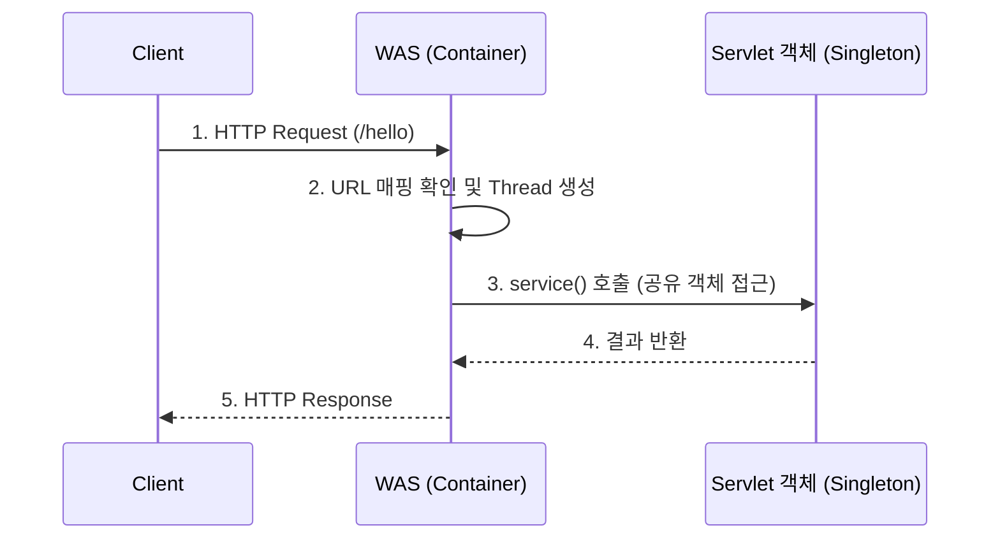
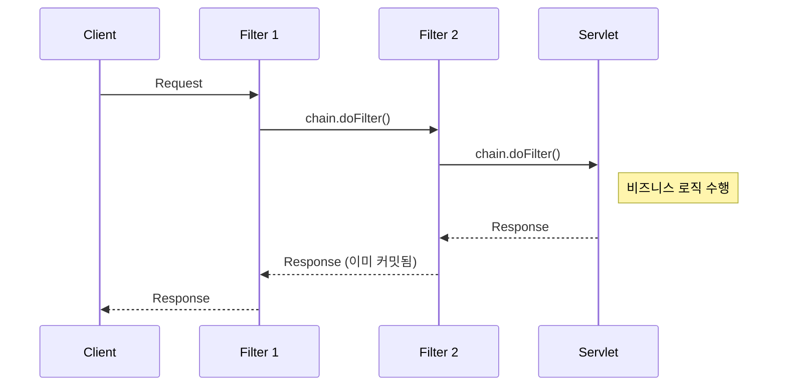

# [Backend] Servlet 완벽 정리본 (1, 2편 통합)

본 문서는 삼성청년SW·AI아카데미(SSAFY) Backend - Servlet 강의 (PPT 1, 2편 통합)의 모든 내용을 상세히 해체하고, 시각적 이해를 돕는 다이어그램과 표를 포함하여 작성한 최종 요약본입니다.

---

## 1. 웹 프로그램 아키텍처 및 개발 환경

### 1.1. 프론트엔드와 백엔드의 역할 분담

| 구분 | 주요 기술 | 역할 및 특징 |
| :--- | :--- | :--- |
| **FrontEnd** | HTML, CSS, JavaScript | 사용자 인터페이스(UI), 페이지 구조와 디자인, 이벤트 처리 등 고수준 상호작용 (Presentation & Behavior) |
| **BackEnd** | Java, Servlet, DB | 비즈니스 로직 처리, 데이터베이스 연동 및 영속성(Persistence) 관리 |

### 1.2. 3-Tier Architecture (3계층 구조)
애플리케이션을 논리적/물리적으로 분리하여 독립적인 업데이트와 확장이 가능하도록 만든 구조입니다.

```mermaid
graph LR
    A[Client] -->|정적 요청 (HTML, CSS)| B[Web Server \n Presentation Tier]
    B -->|동적 요청| C[WAS / Servlet \n Application Tier]
    C <-->|Query / Data| D[(Database MySQL \n Data Tier)]
```

### 1.3. WAS, Container, Context의 관계
*   **WAS (Web Application Server)**: HTTP 기반 통신(주로 8080포트)을 하며 내부적으로 서블릿을 실행하는 엔진(Container) 포함.
*   **Context**: WAS 내에서 동작하는 개별 애플리케이션의 실행 환경.
    *   *경로 예시*: `http://localhost:8080` (Container Root) -> `http://localhost:8080/contextA` (Context Root)

---

## 2. Servlet (서블릿) 기초 및 생명주기

서블릿은 WAS 내부에서 실행되며 클라이언트의 요청을 받아 동적으로 응답을 생성하는 **Java Web Component**입니다.

### 2.1. 서블릿 동작 방식 (Multi-Thread)


*   **장점**: Java OOP 기반, 높은 성능 (1개의 Singleton 객체를 Multi-Thread가 공유).
*   **단점**: 비즈니스 로직(Java)과 프레젠테이션 로직(HTML)이 혼재되어 유지보수가 어려움.

### 2.2. Servlet Life Cycle (생명 주기)
개발자가 아닌 **WAS(Container)가 관리**합니다.

| 라이프사이클 훅 | 동작 방식 | 주요 용도 |
| :--- | :--- | :--- |
| **`init()`** | 최초 1회 생성 시 호출 (초기화 전엔 요청 처리 불가) | DB 커넥션 등 자원 초기화 |
| **`service()`** | 요청이 올 때마다 스레드에 의해 호출됨 | HTTP 메서드(GET/POST)에 따라 `doGet`, `doPost`로 분기 |
| **`destroy()`** | WAS 종료, 앱 재배포 시 최후 1회 호출 | 초기화된 자원 해제 및 정리 작업 |

---

## 3. HTTP 통신 객체 (Request / Response)

### 3.1. HTTP 메서드 (GET vs POST)

| HTTP 메서드 | 요청 Body 유무 | 멱등성 (Idempotent) | 캐시 가능 여부 | 설명 |
| :--- | :--- | :--- | :--- | :--- |
| **GET** | 없음 | **O (예)** | O | 데이터를 읽거나 검색할 때 사용. 파라미터가 URL에 노출됨. |
| **POST** | **있음** | X (아니오) | X | 상태 변화를 일으키거나 대용량 데이터를 전송할 때 사용. |

### 3.2. HttpServletRequest 주요 API
요청 데이터를 추출하는 데 사용되며, 파라미터는 **항상 문자열**로 반환됩니다.

| API 메서드 | 설명 |
| :--- | :--- |
| `getMethod()` | 클라이언트의 HTTP 요청 방식(GET, POST 등) 반환 |
| `getParameter(String name)` | 단일 파라미터 값 추출 |
| `getParameterValues(String name)`| 체크박스 등 다중 값을 배열(`String[]`)로 추출 |
| `setAttribute()` / `getAttribute()` | Request 객체 내부에 데이터를 저장하고 꺼낼 때 사용 |

### 3.3. HttpServletResponse 및 HTTP 상태 코드
응답을 세팅할 때는 출력(Writer)을 열기 전에 **반드시 Content-Type과 Encoding을 먼저 설정**해야 합니다.
*   예: `response.setContentType("text/html; charset=UTF-8");`

| 상태 코드 범주 | 주요 상태 코드 | 의미 |
| :--- | :--- | :--- |
| **2xx (성공)** | `200 OK`, `201 Created` | 요청이 정상적으로 처리됨 |
| **3xx (리다이렉트)**| `302 Found` | 요청한 리소스의 위치가 임시 변경됨 |
| **4xx (클라이언트 오류)**| `400 Bad Request`, `401 Unauthorized`, `404 Not Found`, `405 Method Not Allowed` | 문법 오류, 권한 없음, 리소스 없음, 지원하지 않는 메서드 |
| **5xx (서버 오류)** | `500 Internal Server Error` | 서버 내부 코드 에러 |

---

## 4. Front Controller Pattern (프론트 컨트롤러 패턴)

개별 서블릿마다 중복되는 로직(인코딩, 로깅, 예외처리 등)을 제거하기 위해, **모든 요청을 단일 진입점(Front Controller)에서 받아 공통 처리 후 개별 로직으로 분기**하는 패턴입니다.

### 4.1. 동작 다이어그램

```mermaid
graph TD
    A[Client Request] -->|/main?action=gugu| B(Main Controller \n Front Controller)
    B -->|1. 공통 전처리 \n Logging, Encoding| C{Action Param 파악}
    C -->|gugu| D[gugu() \n 구구단 로직]
    C -->|login| E[login() \n 로그인 로직]
    D --> F[공통 후처리 및 HTML 응답]
    E --> F
```

### 4.2. URL Mapping 전략 비교

| 매핑 방식 | 형태 | 특징 | 비고 |
| :--- | :--- | :--- | :--- |
| **경로 기반** | `/board/*` | 특정 도메인 산하의 모든 요청 처리 | `getPathInfo()`로 세부 경로 파악 |
| **확장자 기반** | `*.do` | 경로 상관없이 특정 확장자 요청 처리 | `getServletPath()`로 파악 |
| **디폴트 매핑** | `/` | 매핑되지 않은 모든 요청 처리 (정적 리소스 주의) | Spring MVC의 기본 매핑 방식 |
| **파라미터 기반**| `/main?action=XX`| URL은 고정하고 쿼리스트링으로 작업 구분 | 강의 예제에서 주로 사용됨 |

---

## 5. Filter 와 Listener

### 5.1. Filter (필터)
서블릿 실행 **전/후**에 요청과 응답을 가로채서 인코딩, 보안(XSS, CSRF), 인증 등의 공통 기능을 수행합니다.



*   **XSS(Cross-Site Scripting) 방어 팁**: Request의 파라미터는 읽기 전용이므로, `HttpServletRequestWrapper`를 상속받아 `getParameter()`를 재정의하여 `<`를 `&lt;`로 치환하는 로직을 삽입해야 합니다.

### 5.2. Listener (리스너)
웹 애플리케이션에서 발생하는 특정 **이벤트(Event)를 모니터링**합니다.

| 리스너 종류 | 설명 |
| :--- | :--- |
| `ServletContextListener` | 웹 애플리케이션 시작/종료 시점 모니터링. 무거운 공유 자원 초기화에 사용. |
| `HttpSessionListener` | 세션 생성/소멸, 속성 변경 이벤트 감지 |
| `ServletRequestListener`| 개별 요청의 시작과 끝 감지 |

---

## 6. Servlet과 Multi-Thread 동시성 이슈

WAS는 효율성을 위해 서블릿을 **Singleton(단일 객체)**으로 생성하고, 여러 스레드가 이를 공유합니다.

*   **문제 발생**: 서블릿 내에 전역 변수(멤버 변수, 예: `private long stock = 1;`)를 선언하고 수정하면, 다수의 스레드가 동시에 접근해 **데이터가 훼손(Thread-Safe 하지 않음)**됩니다.
*   **해결책**:
    1.  **멤버 변수 사용 지양**: 가급적 메서드 내부의 **지역 변수**만 사용하는 Stateless 구조 설계가 최선입니다.
    2.  **동기화(Synchronization)**: `synchronized` 블록(뮤텍스)을 쓰면 데이터는 안전하지만, 1차선 도로처럼 병목이 발생해 **성능이 극심하게 저하**되므로 지양해야 합니다.