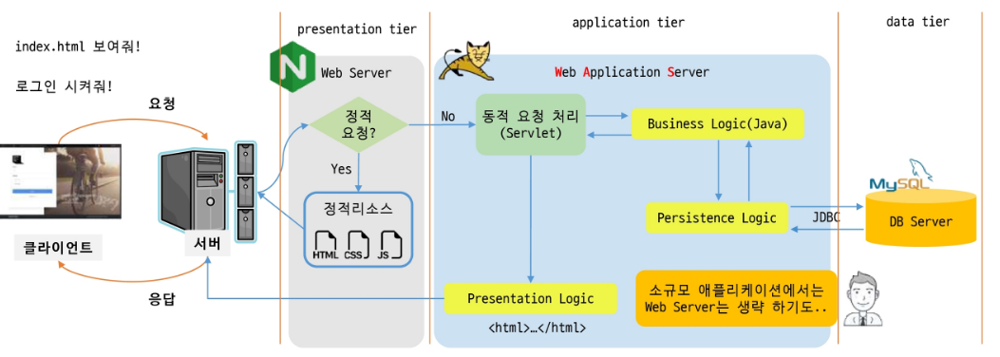

# Servlet1

백엔드 - 비즈니스 로직

3-Tier Architecture

- 애플리케이션을 3개의 논리적 및 물리적 컴퓨팅 계층으로 분리해서 운영
- Presentation tier
    - Web Server
        
        정적 요청을 정적 리소스 줌
        
- application tier
    - WAS: Web Application Server
        
        동적 요청 처리(Servlet)
        
        - Business Logic(Java)
        - Persistence Logic
            - data tier랑  JDBC를 통해 으쌰으쌰!
            - 톰
        - Presentation Logic
            - 응답 ⇒ html로 만들어줌
            - 아파치
- data tier
    - MySQL

[http://localhost:8080](http://localhost:8080) ⇒ container root ⇒ was

was는 동시에 여러 가지 웹 어플리케이션이 동작가능

[http://localhost:8080/contextA](http://localhost:8080/contextA) ⇒ context root

- Container와 Context의 차이
    - container root와 Context root의 차이

- web.xml

src/webapp⇒ 정적파일 만듦

src/webapp ⇒ index.html

- maven

java 기반의 프로젝트 관리 도구로 주로 **빌드 자동화와 의존성 관리**에 사용

장점

- 프로젝트 구조 표준화
- 의존성 관리
- 빌드 자동화

anotation???

@WebServlet

⇒ 너무 헷갈린다.

컨테이너 루트에 컨텍스트 루트까지 포함해야 찾아갈 수 있다.

컨텍스트에 컨테이너 주소 넣으면 안 된다.

life cycle 관련 메서드

- init()
- service()
- destroy()

처음 요청 ⇒ Servlet을 new! ⇒ init() ⇒ service()

나중 요청 ⇒ service()

was 종료 혹은 redeploy 등 ⇒ destroy()

정보 조회

