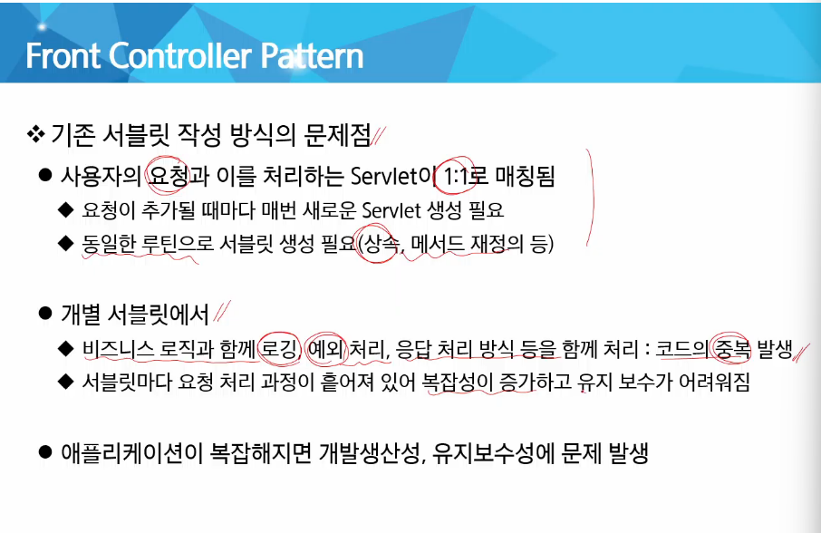

# Servlet2

FrontController는 어떻게 요청을 구분할 수 있을까?

`/*` 이렇게 쓰면 정적 리소스까지 블랙홀로 빨아들이므로 주의

`/` 이미 정적 요청에 대한 재정의이므로 이에 대한 처리 필요

## Filter

여러 개의 컨트롤러에 부분적으로 필요한 공통 기능을 URL 적용 규칙 기반으로 적용시켜보자.

`<` 이런 것들 태그로 동작하지 않게 걸러줌

chain.doFilter()을 해줘야 다음 filter 호출

맨 마지막은 Servlet까지 감 ⇒ Servlet이 응답하면 다시 순서대로 돌아옴

하나의 매서드 내에서 세 영역으로 쪼개서 써야 함

맨 밑에서는 forward 나 redirect를 쓰면 안됨

## Listener

## Servlet과 멀티쓰레드

- Multi thread와 공유 자원 문제
    
    
    

