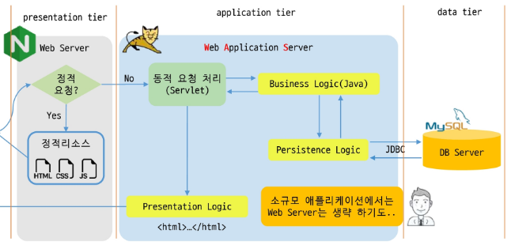

# 제목 없음

3 tier architecture : presentation, application, data

물리적인 서버는 네트워크에서 접근하기 위해 IP 주소 있음(HTTP 통신)
WAS(Web Application Server) 일반적으로 80 포트(웹 서비스), 8080 포트(개발용)
WAS -> Servlet/JSP 실행 엔진 포함
※ WAS에서 동시에 여러 개 웹 애플리케이션 동작 가능 / 각 애플리케이션의 실행 환경과 정보 제공하는 것을 Context라고 함

사용하는 라이브러리가 다양해지면 버젼 문제 발생 가능 → maven / Java 기반의 프로젝트 관리 도구로 빌드 자동화와 의존성 관리에 사용

하나의 서블릿 객체를 생성해 멀티스레딩 지원 / 요청 동시 처리 가능

필터를 통한 공통 모듈 전/후 처리, 리스너를 이용한 이벤트 기반 처리, 다양한 프레임워크와 통합 용이

business logic과 presentation logic(HTML code)가 섞여서 나타남 → Servlet + JSP의 Model 2 방식으로 처리

컨테이너가 life cycle에 따라 서블렛 관리

메서드명

init() / 어떤 요청도 init이 종료되기 전에는 처리될 수 없음 / Servlet에서 필요한 자원 초기화

service() / 실제 사용자의 요청을 처리하는 메서드 / 요청 방식에 따라 doGet(), doPost() 호출

destroy() / 어떤 요청이라도 처리하고 있으면 destroy는 동작하지 않음 / init에서 초기화한 자원의 정리 작업

HttpServletRequest, HttpServletResponse
 Http의 Request, Response를 추상화하기 위한 인터페이스

content type → 서버와 클라이언트가 데이터 주고 받을 때의 데이터 타입 미리 알려줌

- 실행 버젼 문제 해결
    
    
    
    
    
    
    
    Preferences 메뉴에서 확인
    
    이클립스 상단 메뉴에서 Window > Preferences를 클릭합니다.
    
    좌측 메뉴에서 Server > Runtime Environments로 이동합니다.
    
    목록에서 Apache Tomcat v11.0을 선택하고 우측의 Edit... 버튼을 클릭하여 JRE 버전을 확인하고 변경