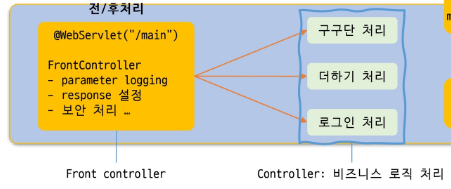

# SERVLET 2

기존 서블릿 작성 방식의 문제점
⇒ 사용자의 요청과 이를 처리하는 Servlet이 1:1로 매칭됨
요청이 추가될 때마다 매번 새로운 Servlet 생성 필요 (상속, 메서드 재정의 등) / 코드 중복 발생

FrontController

전면에서 요청을 받아들이는 Servlet

중요: `/`와 `/*`는 다름

- `/`는 다른 Servlet의 정확한 경로 매핑이나 확장자 매핑이 우선 적용될 수 있음
- `/*`는 경로 매핑이므로 확장자 매핑보다 우선순위가 높음

`/` → 다른 매핑에 해당하지 않는 요청을 처리하는 기본 매핑

Filter = 웹 컴포넌트 실행되기 전, 후에 요청, 응답 가로채서 부가적인 기능 수행하는 웹 컴포넌트

Filter Chain = Filter 여러 개

Filter의 주요 용도

- 인증 및 권한 확인 → 비 로그인 또는 권한 부족 시 접근을 차단하고 로그인 페이지로 redirect 처리
- 로깅 → 요청 응답, 추적 / 문제 해결 및 사용자의 행동 분석
- 보안 → 요청을 검사하여 악의적인 코드나 공격 차단

select dispatcher = filter를 적용할 시점(request, forward, include, error)

Listener = 애플리케이션 이벤트 모니터링 객체

ServletContextListener → 웹 애플리케이션 생성에서 소멸까지의 주요 사항 모니터링

개별 서블릿 동작 전에 초기화하는데 비용이 많이 드는 공유 자원 초기화에 주로 사용

서블릿 멀티 스레드 공유 자원 문제

충돌을 방지하기 위한 방법

- 뮤텍스(Mutex)= 공유 구역에 들어갈 수 있는 통로가 단 하나 / 자리가 하나뿐인 화장실과 열쇠 하나
    
    synchronized 블록
    
- 세마포어(Semaphore) = 공유 구역에 들어갈 수 있는 통로가 여러 개 / 자리가 여러 개인 유료 주차장과 주차권
    
    ex) connection pool
    

Servlet은 공유 자원으로 Thread Safe 하지 않음
Servlet이 상태 정보를 가지면 데이터 훼손 문제가 발생할 수 있음

데이터 보호를 위해 synchronized 키워드 사용 → 한 번에 하나씩
synchronized를 통해 동기화 시키면 제대로 성능을 발휘할 수 없음

Servlet에는 멤버 변수를 통해 상태를 관리하지 않