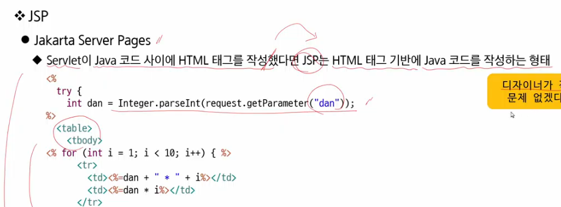

# meme

- 10/28 오전

  Servlet 별로군요? JSP를 써보는게 어때요? (태그 기반에 Java 코드를 삽입)

  

  

  

  Servlet을 구성하는 life style method

  

  

  

  

  

  

  

  

  

  

  

  Parameter는 클라이언트가 만든다.

  Attribute는 서버에서 만든다.

  

  

  

  client가 view를 호출하는 방법.

  <question? client는 request를 몇 번 요청했을까? → 1번> : forward / 하나의 tomcat server 내부에서 일한다. context.

  

  <question? client는 request를 몇 번 요청했을까? → 2번> / 완전히 외부에서도 가능하다.

  

  

  <forward, redirect 언제 쓰는 것이 좋을까?>

  
- 10/28 오후

  EL/JSTL  **JSP의 각성

  1. MVC 리뷰
  2. EL
  3. JSTL
  4. include directive

  

  Web Application에서의 MVC

  

  

  <?무거운 작업인 load와 save는 언제 하는 것이 좋을까요?>

  

  

  

  

  ---

  ---
