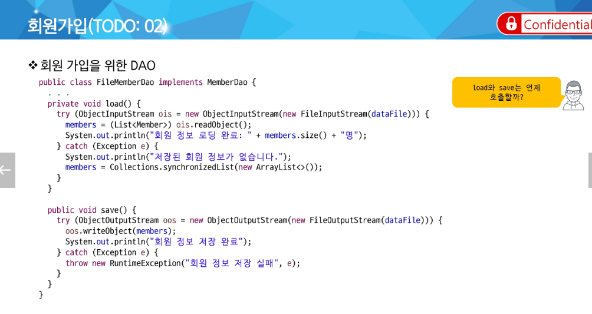

# EL과 JSTL

⇒ load와 save는 리스너에서

⇒양식 == form

el ⇒ 웹스코프에 저장된 attribute를 사용하는데 매우 편리

jstl: jsp Standard Tag Library

⇒ 자주 사용되는 기능들에 대해 정형화된 태그 제공

el은 값이 없을 경우 null이 아닌 공백으로 표시

“User-Agent”는 오해의 소지가 있어서 대괄호해서 표기

header[”User-Agent”]

⇒ ${friends.size()}

# JSTL

Tag Library

같은 말

else는 존재하지 않음

⇒ 이런 게 있긴 함

## 페이지 모듈화

[https://app.notion.com/p/EL-JSTL-407eebeb82d280008e70fe5d9fc9ff39?source=copy_link#407eebeb82d28069a2faec784cdf9fb7](https://app.notion.com/p/EL-JSTL-407eebeb82d280008e70fe5d9fc9ff39?pvs=21)

[https://app.notion.com/p/EL-JSTL-407eebeb82d280008e70fe5d9fc9ff39?source=copy_link#407eebeb82d2801d9034fca67289da5f](https://app.notion.com/p/EL-JSTL-407eebeb82d280008e70fe5d9fc9ff39?pvs=21)

# To do

- [ ]  밑에 코드 위에서 두 줄 왜 적는거지

