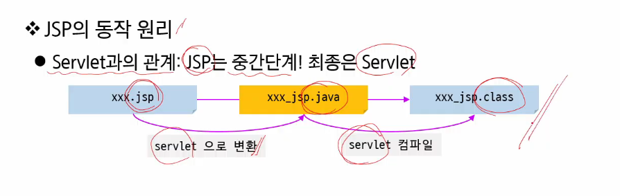

# JSP

jsp는 처음 호출 시 java로 변환하는 과정이 필요하다.

contentType과 import만 우리가 바꿔서 사용!

html 주석은 클라이언트에도 보이기 때문에 JSP comment 사용! JSP에서만 보임

# 상태 관리와 Web scope

# MVC 디자인 패턴

## Model 1 방식

⇒ 어쩐지 왜 쓰나 했네

## Model 2 방식

⇒ 모듈화!

### C는 어떻게 V를 호출하지?????

- forward!!!!!
    
    
    
    controller가 받았던 request와  response를 JSP에 그대로 전달~~
    
- redirect
    
    
    
    다른 웹 자원이 대신 호출되도록 할 수 있다.
    
    서버 내부 리소스 뿐 아니라 외부 리소스까지 사용 가능!
    

⇒ sendRedirect()는 외부로 나가기 때문에 /를 사용하면 container root!! forward는 내부니까 context root~~

### MVC 만들기

- 예제
    
    
    
    
    
    
    

레전드… 변수 이렇게 씀 ㅎㄷㄷ

- [x]  forward와 redirect의 차이 다시 생각하고 언제 쓰는 게 좋을지 생각 좀

자바 스크립트 영역에서도 쓸 수 있다.

