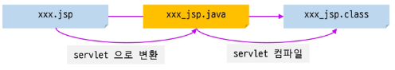

# JSP

---

구조 간단 / 개발 속도 빠름

비지니스 로직과 프레젠테이션 로직 혼합 / 유지보수 어려움

컨테이너가 서블릿, JSP 호출 (RequestDispatcher#forward or HttpServletResponse#sendRedirect)

EL(Expression Language)

- 표현 즉 출력을 위한 언어로 JSP의 expression(<% =. .. %>) 대체
- 단순한 출력은 물론 특히 웹 스코프에 저장된 attribute를 사용하는데 매우 편리

JSTL : Jsp Standard Tag Library

자주 사용되는 기능들에 대해 정형화된 태그 제공

별도의 라이브러리 추가 설치 필요

JSTL

Tag Library / 개발자가 특정 비즈니스 로직이나 기능 수행을 위한 태그를 직접 정의해서 사용하는 것 / 사용자 정의 태그

- Tag Library 중 자주 사용되는 기능을 모아서 제공하는 태그 모음
- 주요 기능: 코어(변수 선언, 조건문, 반복문), 데이터 포맷팅, XML 처리, 데이터베이스 활용, 국제화 등
- 주로 EL과 함께 사용되며 Script-let 대비 간결한 페이지 작성에 유리

