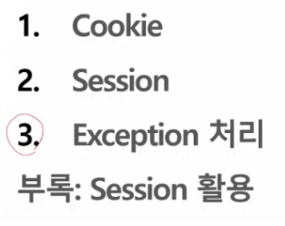

# meme

- 10/29 오전
    
    
    
    HTTP의 특징 : Stateless(상태를 기억하지 않음) 
    
    
    
    이번주는 배경지식, 상식 쌓는 시간
    
    jakarta.servlet.http.Cookie
    
    
    
    
    
    
    
    
    
    Cookie는 생성도 중요하지만 클라이언트에 전달되어야한다. 
    
    forward : response가 저장되어야 브라우저에 전달이 된다. (??? 무슨 소리지…. 으어???)
    
    그냥 대사를 적어보기..
    
    자, 쿠키를 만들고 사용해보자. 라고 하는거네요 
    
    쿠키를 만들 때는 new Cookie하면서 key, value 형태로 데이터를 전송할 수 있고 
    
    유효기간을 꼭 줘야된다고 그랬죠? 
    
    그리고 쿠키를 만든다고 끝나는게 아니라 
    
    쿠키는 뭘 해줘야해요? 
    
    반드시 응답을 통해서 내려보내줘야해요. 
    
    요게 꼭 있어야됩니다. 
    
    가끔 이제 요거를 깜빡하고 쿠키를 만들기만하고 안 내려보내주는 친구들이 있어요. 
    
    응답을 통해서 내려보내줘야한다. 뭐 그런 식으로 만들어볼 수 있고 
    
    두 번째 같은 경우는 value에 지금 공백이 있으니까 URLEncoder를 이용해서 해본 거고요 
    
    그리고 MaxAge? 뭐 요렇게 유효기간을 다르게 해서 쿠키들을 만들어봤습니다. 
    
    그리고 쿠키를 요렇게 만든 다음에 그러면 이제 만든 다음에 
    
    응답을 통해서 내려보내잖아요? 
    
    내려보내주면? 다음 페이지에서~ 요 check-cookie에서 쿠키를 확인할 수 있는거죠 
    
    그러며는 check-cookie에서 cookie를 확인할 때는 이제 으어.. server를 통해서 cookie가 날아갈 때는 cookie가 뭐를 통해서 날아간다 그랬죠? 요청을 통해서 날아간다고 그랬죠. 
    
    request.getCookies()라는 메서드를 사용하게 되면 cookie의 목록이 다 얻어질거에요. 그리고 cookie를 쭉 반복 돌리면서 cookie에서 가지고 있는 이름과 value를 끄집어내볼 수 있겠죠. 
    
    이해되셨을까용? 
    
    그래서 쿠키는 생성도 중요하지만 어디에 저장되어야 사용할 수 있다? 
    
    client에 저장되어야 사용될 수 있다. 요게 중요한겁니다. 
    
    그리고 여러분 잘 이해했는지 살짝쿵 퀴즈 한번 내볼까요? 
    
    make-cookie가 지금 Servlet이잖아요? 얘가 Servlet일꺼고 우리는 MVC 디자인 패턴을 이용해서 application을 구성하고 있어요. 어제부터. 
    
    그러면 make-cookie가 Servlet이고 얘가 jsp니까 요렇게 호출했을텐데 그러면 요
    
    check-cookie.jsp에서 쿠키를 확인하려면 나는 이거를 어떤식으로 호출해야될까요? 
    
    Servlet에서 jsp를 부르는 방법이 뭐가 있었어요, 어제? 
    
    forward를 하거나, redirect를 하거나- 라고, 그랬거든요. 
    
    그랬을 때, 여기를 부르려면, forward로 불러야 될까, redirect로 불러야 될까.
    
    forward가 많네요? 왜 forward죠? 
    
    왜 forward죠? 
    
    왜 forward죠 여러분 
    
    왜 forward로 불러야될까요-? 
    
    forward로 부르면- 여러분-
    
    forward로 전달되면-
    
    이 jsp 페이지가 불려질 때 그 사이에 response가 client로 가나요- 안 가나요-? 
    
    forward로 호출하면 check-cooke.jsp가 client가.. 그쵸, 안 갔죠, 아직 안 갔잖아요 
    
    그러니까 얘를 forward로 호출해버리면 cookie가 client의 브라우저에 전달될 기회가 아직 없는거에요. response가 도착해야 그 때 브라우저에 땅 저장이 된다는 거에요. 이해되셨나요? 
    
    그래서 쿠키 만들면서 많-이 하는 실수가 그거에요. 
    
    많이 하는 실수가? 얘를 만들어놓고 그냥 forward로 얘를 불러, 그런데 그 시점에서는 response가 아직 client한테 가지 않았기 때문에 cookie는 브라우저에 없고 그 상태에서 다시 그 request가 준 getCookie 해보면 이 request는 어떤 친구였어요? 아까 그냥 깨끗한 상태에서 올라온 request잖아요. 그러니까 거기에는 당연히 cookie가 없다는거죠. 이해되셨죠? 
    
    그러니까 프로젝트 나중에 하다보면 그런 질문이 꼭 와요 …. (생략) 
    
    
    
    <??client로는 cookie가 몇 개 내려갈까요?>
    
    내려가는건 3개, 내려가자마자 유효기간 0인게 삭제됨. 내려가긴함 브라우저를 지우기 위해 0인 쿠키를 내려보내준다. 
    
    
    
    
    
    
    
    
    
    
    
    
    
    cookie는 map이니까 forEach를 통해 순회할 수 있다. 
    
    
    
    
    
    
    
    
    
    
    
    -1 : 세션 종료 후 삭제 
    
    1분 후 삭제 등등..
    
    구구단
    
    
    
    
    
    
    
    
    
    <Session>
    
    
    
    
    
    
    
    
    
    
    
    
    
    or
    
    
    
    empty : 상황에 따라서 화면을 전환할 때 사용
    
    
    
    
    
    invalidate 서버에 남아있는 공간을 완전히 없애버리는 것 
    
    
    
    세션을 확인하는 과정을 filter로 만들어보자. 
    
    (각 페이지마다 만들어서 처리할 수도 있겠지만 공통 모듈을 만들어서 처리하는 것이 좋겠다.)
    
    
    
    
    
    
    
    
    
    
    
    
    
    
    
    controller에 진입하지 못한 경우 처리하지 못하기 때문에 WAS를 일부 수정해야한다. 
    
    
    
    범용적인 처리, TOMCAT이 하도록 하는 것 
    
    
    
    
    
    
    
    에러가 발생하면 로깅도 해야한다. tomcat으로 에러를 확인하기 위한 필터 만들기 
    
    
    
    
    
    DispatcherType.request가 default이고 DispatcherType.ERROR로 사용
    
- 10/29 오후
    
    폭풍의 벡엔드 수업 잘 들으셨나요? (→ 나중에 Frame work 수업에서 깨닫게 될 것)
    
    기존에 여러 자격증을 공부하며 어느정도 DB 공부한 부분이 있을 것이다. 
    
    
    
    단일 함수의 반대, 다중행 함수 
    
    (단일 행 함수 ↔ 다중 행 함수)
    
    
    
    
    
    
    
    
    
    
    
    
    
    
    
    
    
    
    
    
    
    
    
    
    
    
    
    
    
    NULL 은 NULL이다. 
    
    TRUE AND NULL → NULL
    
    FALSE AND NULL → FALSE
    
    TRUE OR NULL → TRUE
    
    FALSE OR NULL → NULL 
    
    
    
    
    
    
    
    
    
    
    
    
    
    Null 값에 대한 처리해주기 
    
    
    
    
    
    
    
    pair wise 비교 
    
    
    
    
    
    
    
    
    
    
    
    
    
    
    
    1, 2, 3, 4 중에 해당사항 없을 경우 NULL 
    
    
    
    <내장 함수> 
    
    DB안에 이미 구현되어서 포함되어 있는 함수
    
    
    
    
    
    round(123.456, -1) → 120
    
    truncate(123.456, 2) → 123.45
    
    
    
    
    
    
    
    
    
    
    
    
    
    
    
    IF문에 IF ELSE 중첩될 수 있다. 
    
    정답은 추후 GIT Lab에 올라올 예정