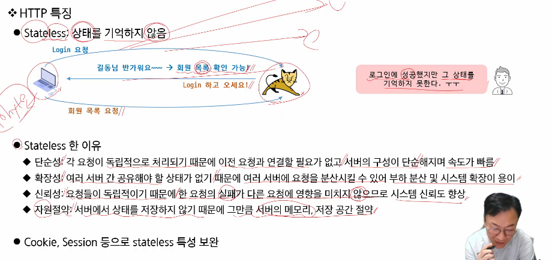

# Cookie와 Session



Http는 Stateless

Cookie와 Session으로 Stateless를 저장

# Cookie

value에 공백이 있을 땐, URL인코더로 인코딩 해야 한다


path가 설정된 하위 경로 요청에 대해서만 쿠키 전송

`/` 이렇게 container root로 지정하면 동일 도메인의 다른 애플리케이션까지 접근 가능 ⇒ 보안 이슈


쿠키 유효기간이 0이면 브라우저에 도착하는 즉시 폐기 ⇒ 쿠키 삭제 대용

유효기간 maxAge로 줘도 브라우저에서 제한해놓을 수 있음

- 보안 옵션 3종 세트
    - sercure: HTTPS만 전송 허용
    - httpOnly: 서버만 접근 ⇒ XSS 공격 방지
    - SameSite: 쿠키 전송 가능 사이트 제한


쿠키는 redirect로 전송. 왜냐면, 쿠키는 response에 담기기 때문! redirect를 해서 request 객체를 새로 생성해줘야 적용됨. ⇒ jsp에서는 request로 쿠키 호출


쿠키 3개 다 클라이언트에 도착하고, 도착하자마자 cookie3은 폐기


EL 내장 객체 cookie 있음 ⇒ map으로 저장되어 있음

entry.value ⇒ 쿠키!

장표 잘못나와 있음

```html
<c:forTokens items=*"*${cookie.recentGugu.value }*"* delims=*"-"* var=*"item"*> //특정 문자열이 있을 때, delims를 기준으로 쪼개주는 게 forTokens
```


SetAttriebute로 쿠키 설정 가능

# Session


세션은 서버에 클라이언트의 상태 값을 저장

쿠키는 브라우저(클라이언트)에 저장


invalidate() ⇒ 세션 무효화, logout 처리


쿠키에 비해서 유효기한이 엄청 짧음 → 서버에 저장하기 때문


애플리케이션 별 web.xml에서 context 단위로 유효기간 재정의 가능

invalidate() ⇒ 서버에서 세션이 쓸데없이 공간 차지 못하게 삭제!

# Exception 처리


에러 남기는 Filter 만들어주기!

@WebFilter(dispatcherTypes = { DispatcherType.***ERROR*** }, urlPatterns = { "/*" })

DispatcherType은 Default가 REQUEST 이다!

# 시험 문제 나올 거 같은 거

- 쿠키 경로가 null인 경우와, /만 있는 경우와, 경로가 지정된 경우 쿠키 작동
- 쿠키 유지 시간이 0일 때와 음수일 때 차이
- forward할 때와 redirect할 때 쿠키 상태
- 

# To do

- [ ]  index 화면에서 showAlert 어떻게 동작하는지 확