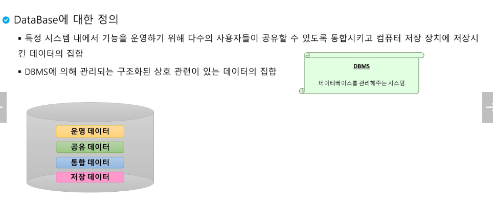

# Select 기본

속성: 개체를 설명하는 세부 단위의 특성/성질

테이블 명이나, View명이나 파생테이블(서브쿼리)를 FROM 뒤에 줄 수 있다.

공백 기준으로 토큰화가 일어나기 때문에, 그런 건 큰 따옴표로 묶어주기!

레코드의 중복 제거

동등비교 `=`  헷갈리지 말 것

NULL은 동등비교 연산이 불가능하니까 IS NULL로 잘 써야함!!

조건절의 논리 연산의 결과가 NULL인 경우 결과집합에서 제거된다.

음수를 넣으면, 소수점 왼쪽에 있는 자리에서 반올림이나 버림

