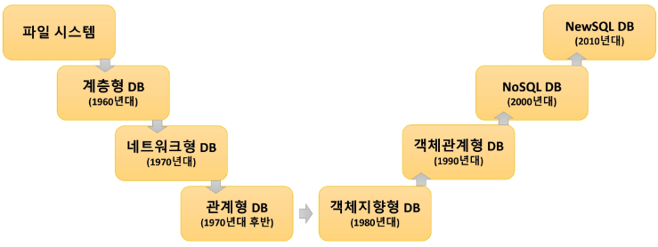

# DB

DataBase = 상호 관련이 있는 구조화된 데이터의 집합

DBMS = 데이터베이스를 관리해주는 시스템

DataBase의 주요 특징

- 실시간 접근 가능(Real-time Accessibility)
- 데이터의 동시 공유(Concurrent Sharing)
- 데이터의 독립성(Data Independence)
- 데이터 무결성(Data Integrity)
- 데이터 중복 최소화(Minimization of Data Redundancy)
- 데이터 보안(Data Security)
- 데이터 일관성(Data Consistency)
- 데이터의 지속성(Data Persistence)

SQL = Structed Query Language

RDBMS의 데이터 관리를 위해 사용하는 프로그래밍 언

SELECT, AS, DISTINCT, WHERE, FROM, ORDER BY, LIMIT

내장 함수

- 반복적으로 사용되어 질 수 있는 부분들을 분리하여 DB에 미리 만들어 놓은 작은 프로그램으로 볼 수 있음
- 기본적인 Query문을 더욱 강력하고 편리하게 사용하도록 도와줌
- 질의가 쉬워지고 응용프로그램의 코딩을 줄여줄 수 있음

단일 행 함수

- 숫자 관련 함수
- 문자 관련 함수
- 날짜 관련 함수
- 변환 함수
- 기타 함수

다중 행 함수

- 집계 함수
- 윈도우 함수

