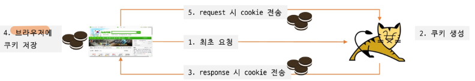

# 쿠키 & 세션

HTTP = Stateless (상태 기억 X)

Stateless 한 이유

- 단순성: 각 요청이 독립적으로 처리되기 때문에 이전 요청과 연결할 필요가 없고 서버의 구성이 단순해지며 속도가 빠름
- 확장성: 여러 서버 간 공유해야 할 상태가 없기 때문에 여러 서버에 요청을 분산시킬 수 있어 부하 분산 및 시스템 확장이 용이
- 신뢰성: 요청들이 독립적이기 때문에 한 요청의 실패가 다른 요청에 영향을 미치지 않으므로 시스템 신뢰도 향상
- 자원절약: 서버에서 상태를 저장하지 않기 때문에 그만큼 서버의 메모리, 저장 공간 절약

#### 쿠키

웹 서버에서 생성 후 웹 브라우저에 보관하는 데이터



주요 property : name, value, path, maxAge, secure, httpOnly, SameSite


경로 미설정 시 context root로 설정

‘/’로 설정시 container root로 설정되어 동일 도메인의 다른 애플리케이션까지 접속 가능

- context root와 container root의 차이
    
    
    
    | 구분 | 의미 | 예시 |
    | --- | --- | --- |
    | Container Root | Tomcat 서버 URL의 최상위 경로 | `/` |
    | Context Root | 특정 웹 애플리케이션의 시작 경로 | `/mvc` |
    
    `cookie.setPath("/mvc");` → `/mvc`, `/mvc/status`, `/mvc/sub` 등으로 요청할 때 쿠키가 전송
    
    `cookie.setPath("/");`→ `/mvc`뿐 아니라 `/shop`에서 요청 시 쿠키 전송
    


추가

XSS(Cross-Site Scripting, 크로스 사이트 스크립팅)는 공격자가 웹사이트에 악성 자바스크립트 코드를 삽입하여 사용자의 브라우저에서 실행되도록 만드는 웹 취약점 공격

CSRF(Cross-Site Request Forgery, 사이트 간 요청 위조)는 사용자가 자신의 의지와는 무관하게, 공격자가 의도한 행동(데이터 수정·삭제, 비밀번호 변경, 자금 이체 등)을 특정 웹사이트에 요청하게 만드는 웹 보안 취약점


```java
cookie.setMaxAge(60 * 1);    // cookie1
cookie2.setMaxAge(-1);       // cookie2
cookie3.setMaxAge(0);        // cookie3
```

| 쿠키 | MaxAge | 동작 |
| --- | --- | --- |
| cookie1 | 60 | 약 60초 후 만료 |
| cookie2 | -1 | 브라우저 세션이 끝날 때까지 유지 / 영구 보관 기한을 설정하지 않는 세션 쿠키 |
| cookie3 | 0 | 브라우저에게 즉시 삭제하도록 지시 |
- 리다이렉트
    
    기존 HTTP 요청에 대한 응답을 받은 뒤 브라우저가 새로운 HTTP 요청을 보내는 것
    
    ≠ 브라우저 자체가 종료되거나 서버 연결이 반드시 끊어진다는 의미
    
    
    
    쿠키, 세션은 리다이렉트하더라도 일반적으로 유지됨
    
    WebSocket = HTTP Upgrade 핸드셰이크를 거쳐 WebSocket 연결을 수립한 뒤 양방향 통신을 진행
    
    일반 HTTP 요청에서 Redirect가 발생한다고 기존 WebSocket 연결이 자동으로 종료되는 건 아
    
    브라우저가 Redirect로 다른 페이지를 실제로 탐색하면서 이전 페이지의 JavaScript 실행 환경이 사라지면 그 페이지가 생성한 WebSocket 연결도 일반적으로 종료
    
    `fetch()` 요청에서 Redirect를 따라가는 경우에는 페이지 자체가 바뀌지 않으므로 기존 WebSocket 연결이 유지될 수 있음 / 같은 페이지에서 별도 HTTP 요청만 Redirect되는 경우에는 WebSocket이 유지될 수 있음
    


#### Session

- 서버에 클라이언트의 상태 값을 저장
- 하나의 브라우저 당 하나의 세션 성립
- 쿠키는 브라우저를 닫아도 유지될 수 있으나 세션은 브라우저를 닫으면 종료

세션이 동작하기 위해서는 JSESSIONID라는 이름의 쿠키 필요


HttpSession의 유효기간 설정

- WAS의 web.xml에 container 차원의 session-timeout 설정
    
    설정 시간은 **분** 단위
    
    애플리케이션 별 web.xml에서 context 단위 재정의 가능
    
    ```html
    <session-config>
    <session-timeout>30</session-timeout>
    </session-config>
    ```
    

- HttpSession#setMaxInactivelnterval(int sec)을 통해 프로그래밍적으로 재정의 가능
    
    **초** 단위로 세션의 유효 기간 설정
    

session. invalidate()와 session. removeAttribute("loginUser")의 차이는?


세션 안에 있던 다른 속성들도 못 씀 / invalidate


#### Exception 처리

예외에 대한 정보가 클라이언트에게 직접 전달되지 않도록 처리 필요 / 사용자에게 표시되는 페이지와 문제 해결을 위한 로깅이 병행되어야 


Fallback = 원래 처리 방식이 실패했을 때 사용하는 대체 처리 방법


DispatcherType = Servlet Container(Tomcat)가 특정 리소스를 호출하는 방식 또는 디스패치 유형

| DispatcherType | 의미 |
| --- | --- |
| `REQUEST` | 클라이언트의 일반적인 HTTP 요청 |
| `FORWARD` | 서버 내부에서 다른 Servlet/JSP로 요청 전달 |
| `INCLUDE` | 다른 리소스의 결과를 현재 응답에 포함 |
| `ERROR` | 오류 페이지로 디스패치 |
| `ASYNC` | 비동기 처리 관련 디스패치 |

Filter를 어떤 디스패치 상황에 실행할지 지정할 수 있음

```java
@WebFilter(
    urlPatterns = "/*",
    dispatcherTypes = {
        DispatcherType.ERROR
    }
)
public class ErrorFilter implements Filter {

    @Override
    public void doFilter(
        ServletRequest request,
        ServletResponse response,
        FilterChain chain
    ) throws IOException, ServletException {

        System.out.println("오류 페이지 처리 시작");

        chain.doFilter(request, response);
    }
}
```


Filter가 오류를 처리하는 Servlet보다 먼저 실행될 수 있어서 오류 페이지에 도달하기 전에 로그를 남기는 공통 처리 실행

```java
@WebFilter(
    urlPatterns = "/error/*",
    dispatcherTypes = DispatcherType.ERROR
)
```


