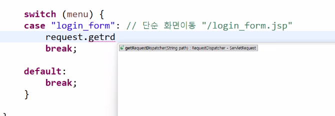

# 제목 없음

- 강사님 보충 수업
    
    
    
    에러 던지기 
    
    
    
    
    
    
    
    이상한 name을 넣어놓고, 오류 생기게 한다. 
    
    대소문자도 신경써야한다. 
    
    벡엔드에서는 name 중요
    
    
    
    로그인 버튼을 누르면 어디로 가는지 흐름을 알 수 있어야한다. 
    
    
    
    
    
    
    
    
    
    Web Project Settings와 
    
    경로가 맞아야한다. 
    
    만들어놓은 변수 root 사용해서 이렇게 작성할 수도 있다. 
    
    
    
    이 순서로 작업한다. 
    
    
    
    - `index.jsp`
    - `headernav.jsp`
    - `login_form.jsp`
    - `MemberController.java`
    - `MemberService.java`
    - `MemberServiceImpl.java`
    - `MemberDAO.java`
    - `MemberDAOImpl.java`
    
    ctrl + 1 + space 로 인터페이스 만들기 
    
    
    
    filter를 했고 마음에 드는 것을 찾겠다. findFirst()
    
    없으면 null .orElse(null)
    
    
    
    이 과정은 어떤 프로젝트에 가도 똑같다. (평생-) / 아주 기본적인 기능
    
    
    
    <forward 어떻게 하면 되나요?>
    
    
    
    ctrl + 1 에러 던지기 
    
    
    
    이해를 위해 2줄로 작성하고 있다. 
    
    
    
    시험은 이거에 2배-3배 많은 분량으로 나온다. 
    
    
    
    리스트로 보내자 이거는 시험 15번 나왔다. 
    
    어이없이 틀리고, 긴장해서 틀리고, 공부 안 해서 틀린다. 
    
    
    
    NO
    
    로그인을 했으면 로그인 처리를 하고 끝내야 한다. 
    
    로그인하고 저 메소드를 호출하면 안 된다. 
    
    리스트를 담아서 갈 수 있도록, 컨트롤러를 거쳐서 갈 수 있도록 
    
    
    
    
    
    student 대신에 이렇게 쓸 수도 있다. 
    
    
    
    
    
    
    
    로그인 했을 때, “안녕하세요”라고 나올 수 있도록 
    
    header를 수정해야한다. 
    
    에러도 안 나고 그냥 안 된다. 
    
    나중에 프로젝트할 때 주의할 것 
    
    
    
    조건식 안, 밖의 띄어쓰기에 따라 에러나는 경우 배제하기 위해 붙여쓰기 권장
    
    
    
    집가서 아무것도 없는 상태에서 2번-3번 해보기 
    
    