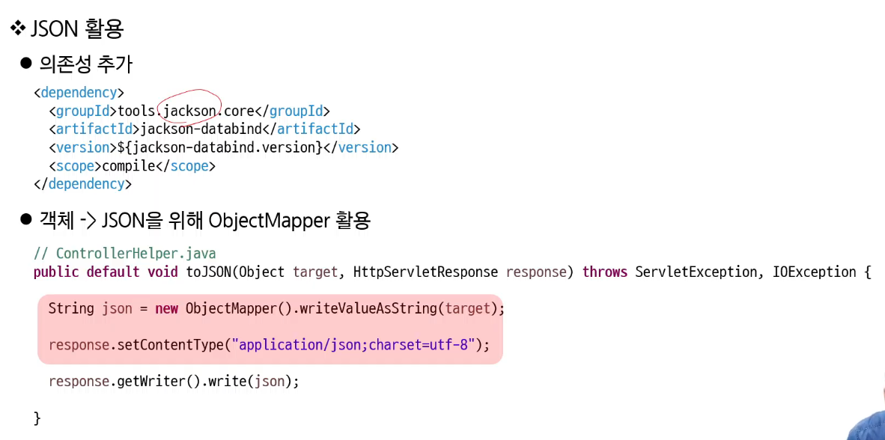

# 관통DAY

# Ajax

비동기 구현



json을 편하게 만들어줌


[https://getbootstrap.com/docs/5.3/forms/validation/#server-side](https://getbootstrap.com/docs/5.3/forms/validation/#server-side)

이미 만들어져있는 Validation

- [ ]  이게 되나?? 백키 왜 썼지?? 백틱??
    
    ```html
    <script>
     	document.querySelector("#email").addEventListener("input", async (e) => {
     		const target = e.target;
     		const response = await fetch(`${root}/member?action=email-check&email=${target.value}`);
     		
     	})
     
     </script> 
    ```
    


dto: data transform object 여러 목록을 저장해서 다니는 객체


아래는 View


- [ ]  검색 조건을 유지한 채로 페이지 움직일 땐 클릭 시 검색 Form을 제출하도록 구현??


페이지네이션도 이미 만들어져있음~

[https://getbootstrap.kr/docs/5.3/components/pagination/](https://getbootstrap.kr/docs/5.3/components/pagination/)


- [ ]  사용자 정의 속성은 ‘data-’라는 프리픽스 추가


클릭 해서 form을 동작 시키기로 함

# TO DO